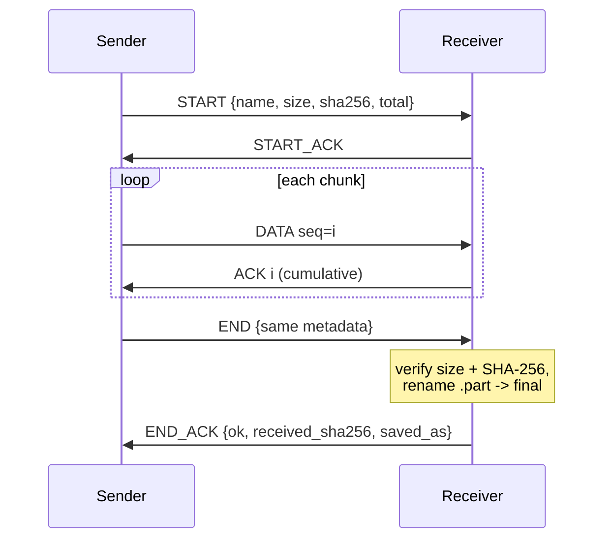
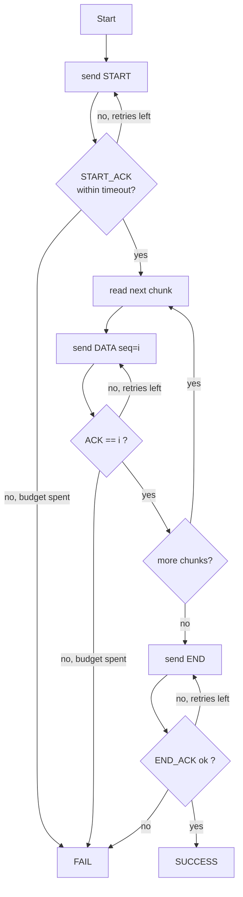
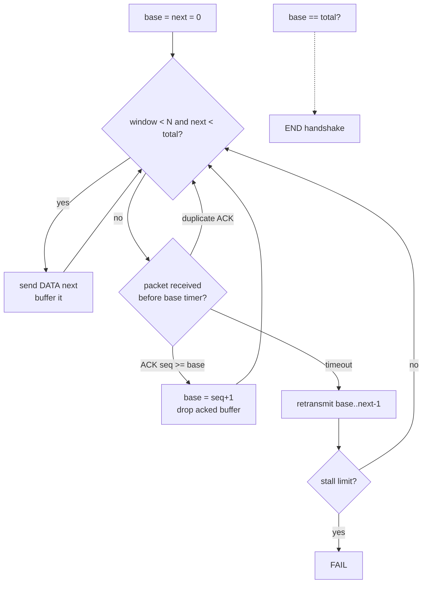
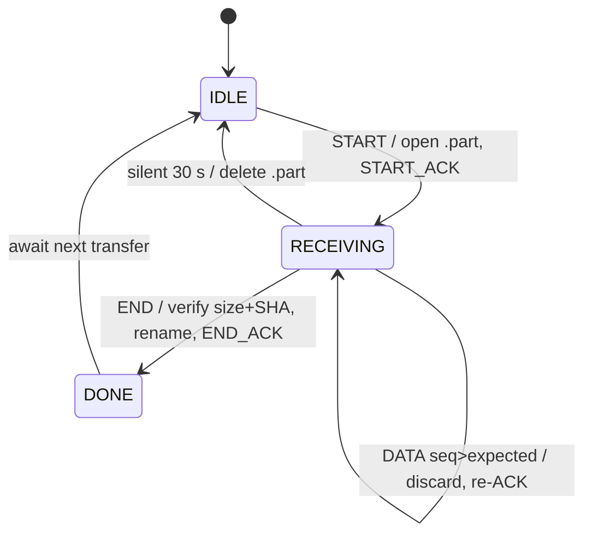

# PROJECT REPORT

## Reliable UDP-Based File Transfer System

**Course project report — Computer Networks**

| | |
|---|---|
| **Priyanshu Gautam** | 24BCE0317 |
| **Rajesh Kumar Gautam** | 24BCE0326 |

---

## 1. Title

Reliable UDP-Based File Transfer System — an application-layer reliability
protocol (ARQ, cumulative acknowledgements, integrity verification) built on
top of the User Datagram Protocol.

## 2. Abstract

UDP provides an unreliable, connectionless transport service: datagrams may
be lost, duplicated, delayed or reordered without any notification to the
sending application. This project designs and implements a complete,
working file-transfer system that restores reliability at the application
layer. The system splits a file into 1000-byte DATA packets carrying
sequence numbers and a transfer identifier, protects every packet with a
CRC-16 header checksum, and delivers files using an ARQ scheme available in
two modes — a stop-and-wait baseline and a sliding-window Go-Back-N mode
with cumulative acknowledgements. A three-way START/DATA/END handshake ends
only when the receiver has independently verified the received file's size
and SHA-256 digest and confirmed this to the sender with an END_ACK. A
built-in, seed-controlled network simulator injects packet loss, ACK loss,
delay, reordering and duplication so the recovery mechanisms can be
demonstrated and measured repeatably. On loopback experiments with a
100 KiB file, the sliding-window mode sustained 243 kbit/s at 20 % packet
loss versus 101 kbit/s for stop-and-wait. An automated suite of 60 tests
passes, covering corruption, duplication, loss, timeouts, filename safety
and end-to-end integrity. All results quoted in this report come from
executions that actually ran on the development machine; none are estimated.

## 3. Introduction

The two transport protocols of the Internet stack occupy opposite ends of a
spectrum. TCP offers a reliable byte stream but conceals its machinery;
UDP offers only "best-effort" datagram delivery but imposes no connection
setup, no ordering and no retransmission overhead. For multimedia, gaming
and internal LAN tools, UDP's lightness is attractive — until an
application needs a file to arrive *complete and correct*, at which point
the application itself must provide reliability.

This project builds such a mechanism from first principles and makes every
part of it observable: the packet format is a documented binary header, the
ARQ state machines are printable as flowcharts, a simulator can break the
network on demand, and a benchmark harness measures what reliability costs.
The goal is simultaneously practical (files genuinely transfer and verify)
and pedagogical (every classic technique — chunking, sequence numbers,
ACKs, timeouts, retransmission, duplicate suppression, checksums — is
explicit in about 1 800 lines of Python standard-library code).

## 4. Problem statement

Design and implement two cooperating programs, a **sender** and a
**receiver**, that transfer an arbitrary file over UDP such that:

1. the received file is byte-for-byte identical to the original (verified
   by SHA-256), even when datagrams are lost, duplicated or reordered;
2. the sender reports success only after the receiver confirms it has
   verified and stored the file — never on the evidence of a locally
   successful `sendto()`;
3. duplicate and out-of-order packets never corrupt the output;
4. failures (silent receiver, corrupt traffic, unreachable peer) are
   detected, bounded by retries/timeouts, and reported cleanly;
5. the whole mechanism can be demonstrated, measured and repeated,
   including under controlled network impairment.

## 5. Objectives

1. Send files sender → receiver over UDP with 1000-byte packets.
2. Assign sequence numbers and a per-transfer identifier to packets.
3. Acknowledge received packets; retransmit on timeout.
4. Detect and suppress duplicates; reorder data correctly.
5. Recover from simulated data loss, ACK loss, delay, reordering and
   duplication.
6. Verify integrity end-to-end with SHA-256 (and per-packet CRC-16).
7. Report per-transfer statistics (duration, throughput, retransmissions,
   timeouts).
8. Compare stop-and-wait ARQ with sliding-window Go-Back-N ARQ.
9. Provide a threaded GUI that never freezes during transfers.
10. Maintain an automated test suite and reproducible benchmark results.

## 6. Background and related concepts

**UDP (RFC 768)** is a connectionless transport adding only ports and a
length/checksum to IP. It performs no delivery confirmation, ordering,
duplicate detection or flow control.

**ARQ (Automatic Repeat reQuest)** restores delivery confirmation:
stop-and-wait sends one packet and waits for its acknowledgement;
sliding-window protocols (Go-Back-N, Selective Repeat) keep several packets
in flight to use the channel while acknowledgements are pending.

**Cumulative acknowledgements** confirm every packet up to sequence *n*,
which is what a Go-Back-N receiver naturally produces: it accepts only the
next in-order packet and re-ACKs the highest in-order sequence for anything
behind or ahead of that point.

**Checksums and digests**: a per-packet CRC-16/CCITT-FALSE detects
corruption of any datagram; an end-to-end SHA-256 digest (FIPS 180-4) of
the whole file detects any loss/reordering/duplication that could still
alter the result. SHA-256 verifies integrity — not sender identity.

## 7. System architecture

```mermaid
flowchart LR
    subgraph S[Sender process]
        S1[sender.py<br/>ARQ core] 
        S2[network_simulator.py<br/>(optional)]
    end
    subgraph R[Receiver process]
        R2[network_simulator.py<br/>(optional)]
        R1[receiver.py<br/>in-order writer]
    end
    S1 --> S2 -->|UDP datagrams| R2 --> R1
    R1 --> R2 -->|START_ACK / ACK / END_ACK| S2 --> S1
    S1 -.->|statistics| ST[statistics.py<br/>results/*.csv]
    R1 -.->|saves file| OUT[received_files/]
```

* `protocol.py` — wire format, validation, CRC-16.
* `config.py` — defaults and logging.
* `network_simulator.py` — `SimulatedLink`, a drop-in wrapper around a UDP
  socket that impairs the **outgoing** packets of whichever process enables
  it (sender-side → data path; receiver-side → ACK path).
* `statistics.py` — per-transfer records and CSV export.
* `sender.py` / `receiver.py` — CLI programs wrapping importable cores.
* `gui.py` — tkinter front-end (threads + queue + `after()` polling).
* `tests/` — 60 automated tests; `benchmark.py` — experiment driver.

## 8. Protocol design

### 8.1 Packet format

16-byte big-endian binary header + payload:

| Offset | Size | Field | Purpose |
|---:|---:|---|---|
| 0 | 1 | magic `0x52` | reject foreign datagrams instantly |
| 1 | 1 | version `1` | reject future/incompatible formats |
| 2 | 1 | msg_type | START=1, START_ACK=2, DATA=3, ACK=4, END=5, END_ACK=6, ERROR=7 |
| 3 | 1 | flags | reserved |
| 4 | 4 | transfer_id | groups all packets of one transfer |
| 8 | 4 | seq | DATA index / highest in-order seq in ACK |
| 12 | 2 | payload_len | exact payload length |
| 14 | 2 | crc16 | CRC-16/CCITT-FALSE over the whole packet |

START/END carry JSON metadata (`filename, file_size, sha256,
total_packets`); DATA carries up to 1000 raw file bytes; END_ACK carries
the verification verdict; ERROR a code and message. Only JSON and raw bytes
are ever deserialised — never pickle.

### 8.2 Message exchange



Every handshake step is retried on timeout, and the receiver answers
duplicates idempotently: a repeated START gets another START_ACK, a
repeated DATA gets another ACK, a repeated END gets another END_ACK (from a
short-lived result cache) — so a lost ACK can never fail a transfer or
duplicate file content.

## 9. Algorithms and flowcharts

### 9.1 Stop-and-wait sender (Phase 1)



### 9.2 Sliding-window sender — Go-Back-N (Phase 2)



### 9.3 Receiver (one machine, both sender modes)



## 10. Implementation details

* **Language**: Python 3.13, standard library only for the core (socket,
  struct, hashlib, json, threading, tkinter, unittest, argparse); matplotlib
  (optional) draws benchmark charts; pillow (optional) captures screenshots.
* **Bounded memory**: the sender reads chunks on demand and buffers only the
  unacknowledged window (≤ window × 1000 B); the receiver writes in-order
  data straight to disk and hashes the file in 64 KiB blocks.
* **Transfer isolation**: a random 32-bit transfer id; datagrams of other
  ids are counted and ignored; a busy receiver answers ERROR `busy`.
* **Windows robustness**: the code handles `ConnectionResetError` (ICMP
  port-unreachable surfacing on `recvfrom`) and avoids non-blocking UDP
  polling, which is unreliable on Windows — the simulator waits with
  `select()` instead. Both issues were discovered and fixed during testing
  on the development machine.
* **Filename safety**: the receiver flattens any remote filename
  (`basename`, character whitelist, length cap, Windows reserved-name
  prefixing) and never overwrites — collisions become `name_1.ext`.
* **Determinism**: `--sim-seed` seeds all simulator decisions; the same seed
  drops the same packets every run.

## 11. Experimental methodology

All experiments ran on the development laptop (Windows 11, Python 3.13.5)
over the loopback interface, where real loss is effectively zero, so all
impairments are the simulator's *labelled, seeded* injections on the
sender's outgoing path. `benchmark.py` transferred `test_files/medium.bin`
(102 400 bytes = 103 DATA packets) 3 times per cell across loss levels
{0, 2, 5, 10, 20} % and both modes (timeout 0.3 s, retries 12, window 16,
seed base 1000, per-run seed 1000+cell+repeat). 30/30 runs completed
successfully. Metrics — duration, throughput, retransmissions, timeouts —
are counters incremented by the running code and exported to
`results/benchmark_summary.csv`, `results/transfers.csv` and the charts
`results/benchmark_*.png`. Recovery scenarios (dropped DATA, dropped ACK,
dropped END_ACK, reordering, duplication) are additionally verified by the
automated suite.

## 12. Actual results

### 12.1 Benchmark (mean of 3 runs per cell, 100 KiB file)

| Data loss | S&W kbit/s | GBN kbit/s | S&W rexmit | GBN rexmit | GBN timeouts |
|---:|---:|---:|---:|---:|---:|
| 0 % | 3357 | 3483 | 0.0 | 0.0 | 0.0 |
| 2 % | 1045 | 1096 | 1.7 | 42.7 | 2.7 |
| 5 % | 390 | 598 | 5.7 | 80.0 | 5.0 |
| 10 % | 203 | 373 | 12.7 | 179.3 | 12.3 |
| 20 % | 101 | 243 | 26.0 | 399.3 | 27.0 |

### 12.2 Fault-injection runs (single executions, verified)

| Scenario | Settings | Outcome |
|---|---|---|
| Clean transfer | 1820 B, S&W | SUCCESS, SHA verified, 0 rexmit |
| Empty file | 0 bytes | SUCCESS, 0 DATA packets |
| 20 % data loss | window 16, seed 7, 100 KiB | SUCCESS, 366 rexmit, 25 timeouts, receiver discarded 258 out-of-order |
| 25 % ACK loss | S&W, seed 3, 100 KiB | SUCCESS, 28 rexmit (≈ expected drop count) |
| Reorder 15 % + dup 10 % + delay 40 ms | window 16, seed 11 | SUCCESS, 1005 rexmit, receiver saw 105 duplicates, byte-identical file |

### 12.3 Automated tests

`python -m unittest discover -s tests -t .` → **60 tests, 0 failures**
(test_protocol 22, test_transfer 25, test_network_conditions 13), covering
encode/decode and every malformed-input class, empty/small/large/unicode
transfers, both modes, dead-peer timeouts, handshake-loss recovery,
duplicate and out-of-order suppression, size and SHA verification
(including a deliberately lying sender), receiver robustness against
garbage datagrams, overwrite protection and filename sanitisation.

### 12.4 GUI and evidence

The tkinter GUI was exercised end-to-end (failure path with no receiver;
successful transfer with live progress, speed, retransmission counter and
SHA verdict). Genuine screenshots of the running GUI are in
`screenshots/`: receiver listening, sender mid-transfer under 20 % loss,
sender after verification. Transfer logs are in `logs/`.

## 13. Discussion

**Throughput vs. loss.** On a clean loopback both modes are equivalent
(~3.4–3.5 Mbit/s) because the round-trip time is nearly zero — waiting for
an ACK costs almost nothing. As loss rises, stop-and-wait pays one full
timeout (0.3 s) per lost packet, so its throughput collapses roughly as
`1/(1 + loss% × timeout/chunk-time)`; the window keeps 16 packets moving
per timeout period, which is why Go-Back-N reaches 2.4× stop-and-wait's
throughput at 20 % loss (243 vs 101 kbit/s).

**Retransmission cost.** The price of Go-Back-N is visible in the same
table: because the receiver discards out-of-order packets, one loss
invalidates the whole window behind it (397 mean retransmissions at 20 %
loss vs. 26 for stop-and-wait). On links with bandwidth × delay product
larger than the window, or at higher loss, Selective Repeat would be the
next step.

**Correctness before performance.** The single receiver rule — accept only
`seq == expected`, re-ACK `expected-1`, never rewrite — gives duplicate
suppression and ordering for free and serves both sender modes; the
stress run (reorder + duplication + delay simultaneously) still produced a
byte-identical file. The completion handshake mattered in practice: the
END_ACK-loss test shows a retransmitted END being re-answered from the
receiver's result cache without touching the already-saved file.

## 14. Limitations

* Single transfer at a time per receiver; no concurrent sessions.
* Fixed retransmission timeout — no RTT estimation or adaptive backoff.
* Go-Back-N wastes bandwidth after a loss (no selective acknowledgement).
* No flow/congestion control: a huge window can overrun a slow receiver.
* No confidentiality or authentication; SHA-256 proves integrity only, and
  plaintext UDP is readable on the path.
* Sequence numbers do not wrap (caps a transfer at ≈ 4 TB — irrelevant at
  project scale, but a design simplification).
* Simulated impairments affect only the outgoing path of the process that
  enables them; real-network loss is outside the program's control.

## 15. Future scope

1. Selective Repeat with SACK blocks; 2. adaptive timeout via smoothed RTT
   (Jacobson/Karn); 3. multi-transfer receiver with a listen queue;
   4. congestion window (slow start + AIMD); 5. optional AES-GCM
   encryption with key exchange for confidentiality; 6. transfer resume
   from a saved part-file; 7. a Wireshark Lua dissector decoding the
   header fields natively; 8. IPv6/multicast demonstrations.

## 16. Conclusion

The project set out to make UDP reliable at the application layer and did
so with verifiable, measurable results: files of every size from 0 bytes to
1 MiB transfer correctly under injected loss, ACK loss, delay, reordering
and duplication; the receiver's in-order/cumulative-ACK rule guarantees no
duplicates and no misordering; SHA-256 verification closes the loop and the
sender never claims success without the receiver's confirmed verdict. The
benchmark quantifies the classic trade-off — stop-and-wait is simple and
frugal, the sliding window buys throughput at the cost of extra
retransmissions — and the 60-test suite plus seeded simulator make every
claim in this report reproducible by a single command.

## 17. References

1. J. Postel, *"User Datagram Protocol"*, RFC 768, USC/Information Sciences
   Institute, August 1980.
2. J. F. Kurose and K. W. Ross, *Computer Networking: A Top-Down Approach*,
   8th ed., Pearson, 2021 — chapters on the transport layer (UDP, reliable
   data transfer, pipelining, Go-Back-N).
3. A. S. Tanenbaum, N. Feamster and D. J. Wetherall, *Computer Networks*,
   5th ed., Pearson, 2021 — error detection and automatic repeat request.
4. NIST, *Secure Hash Standard (SHS)*, FIPS PUB 180-4, August 2015 — the
   SHA-256 specification.
5. ITU-T, *X.25 error detection procedures / CRC computation* (basis of the
   CRC-16/CCITT-FALSE polynomial 0x1021 used for per-packet checks).
6. Python Software Foundation, *The Python Standard Library* — socket,
   hashlib, struct, tkinter documentation, docs.python.org.
